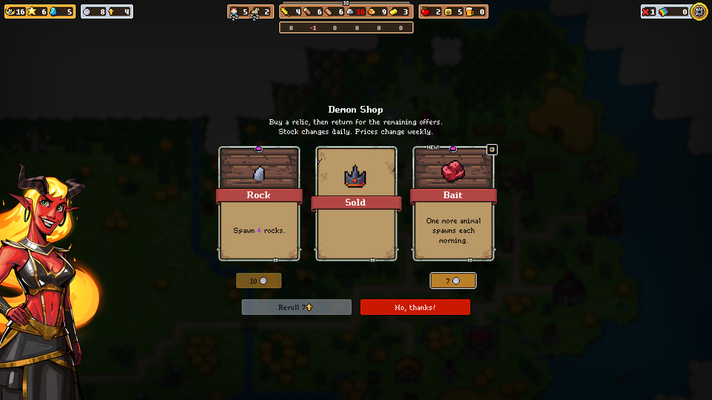
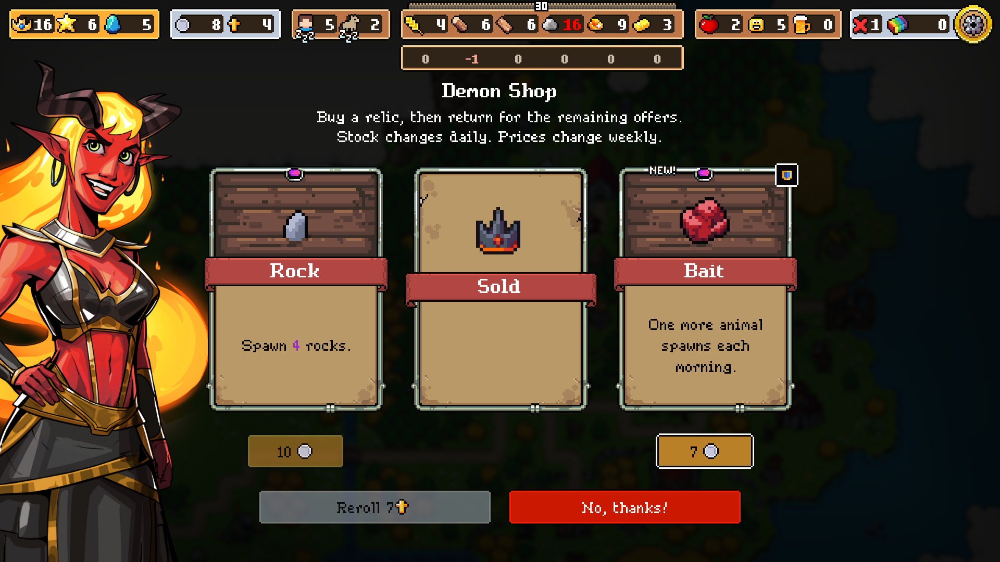

# Amaya Without Cooldown

Once you unlock Amaya's Demon Shop, you can buy a relic and visit her again immediately. On a same-day return, the purchased slot reads **Sold** and the other relics are still available at their usual coin prices.

## Features

- Returning to the shop is free. The purchased slot keeps the relic's icon above its **Sold** ribbon.
- The coin price stays visible on an unaffordable offer. If you lack the Faith for a reroll, you can still see what it costs.
- Stock changes daily. Use **Reroll** for a fresh selection sooner, at the displayed Faith price or with an earned free reroll.
- Continue restores the offers and sold slots saved for that day's shop.

## How to Use

1. Click Amaya on the map, or move the controller cursor over her and press **A**.
2. Click the price beneath a relic to buy it, or focus its buy button and press Confirm (**Enter** or controller **A** by default). After the purchase, select Amaya again to buy another offer.
3. To change the selection, click **Reroll**, or focus it and press Confirm. To leave without buying, click **No, thanks!** or press **Escape** or controller **B**.

## Screenshots

Captured in game on version 0.1.2 at 1920 × 1080 using a virtual controller.

**1× UI scale.** The crown marks the purchased Banished King. With 8 coins, you can still buy Bait for 7.

**1.5× UI scale.** The 10-coin Rock and 7-Faith reroll are out of reach. Both prices remain visible beneath the resource strip.

## Compatibility

- Tested in game with [Weekly Contracts](https://thunderstore.io/c/super-fantasy-kingdom/p/GKJ/WeeklyContracts/) and [Daybook](https://thunderstore.io/c/super-fantasy-kingdom/p/GKJ/Daybook/). The reopened shop clears the resource strip at both UI scales.
- Version 0.1.2 passed offline purchase and reload tests with [MoreRelics 1.1.0](https://thunderstore.io/c/super-fantasy-kingdom/p/ownlyme/MoreRelics/) and with [BakeryUsesWheat 1.2.0](https://thunderstore.io/c/super-fantasy-kingdom/p/ownlyme/BakeryUsesWheat/) also enabled. If a content mod removes a saved offer, its slot shows **Sold** and the other offers keep their positions.
- Older saves can lack the identity of a previously purchased relic. On the first visit, Amaya uses the game's saved reroll state to generate eligible offers.
- A free reroll spends zero Faith at the shop. When Continue replays one recorded reroll from a checkpoint, the base game can deduct one Faith even if that reroll was free.

## Installation

1. Choose **Install with App** on the [Thunderstore listing](https://thunderstore.io/c/super-fantasy-kingdom/p/GKJ/AmayaWithoutCooldown/) and select your **Super Fantasy Kingdom** profile.
2. When prompted, install [BepInExPack](https://thunderstore.io/c/super-fantasy-kingdom/p/BepInEx/BepInExPack/) and [HideManagerGameObject_Config](https://thunderstore.io/c/super-fantasy-kingdom/p/BepInEx/HideManagerGameObject_Config/).
3. Choose **Start modded** and visit Amaya in a run where her shop is unlocked.

## Local import

1. In Thunderstore Mod Manager or r2modman, select **Super Fantasy Kingdom** and a dedicated test profile. Install the BepInEx dependencies listed in the manifest.
2. Open **Settings → Profile → Import local mod** and select `dist/AmayaWithoutCooldown-0.1.2.zip`. In manager versions with a search box, search Settings for **Import local mod**.
3. Choose **Start modded**. In the test profile's `BepInEx/LogOutput.log`, look for **Amaya Without Cooldown is ready.** Use a run where Amaya's shop has already opened.

## Controller playtest

- Record the day, relic names, coin and faith balances, and reroll price. With a relic's buy button focused, press Back and verify the shop closes. Reopen it, focus **Reroll**, and press Confirm. Repeat by clicking **Reroll** while another control has focus.
- Buy a relic. Hold Confirm across the transition, then release it. Verify one grant and one coin deduction. Reopen from the map without advancing time. The bought slot should read sold and the other relics should retain their positions and prices.
- Buy another slot. Try an unaffordable offer and back out. Check that balances only change on successful purchases, focus returns to Amaya on the map, and one Back press closes the shop once.
- Try a paid reroll and, when available, an earned free reroll. Check the displayed charge or free allowance exactly once, fresh eligible stock, and a valid selection afterward. With insufficient faith and no free reroll, the selection and balance should hold.
- Visit with all offers sold. Reach Reroll when eligible or Cancel with the pad. Repeat with keyboard and mouse, then switch back to the pad and check the prompt and focus.
- Save and Continue with partial stock, check the offers again at the game's restored day, then compare at the next natural day refresh. Check that a still-locked Amaya and another merchant behave as usual.

The live shop and virtual-controller checks used 0.1.2. Physical controller testing and a full save-menu round trip with the combined mod set remain open. [Compatibility results](tests/Compatibility/README.md)

## Build and package

Use the installed Windows game assemblies and the BepInEx 5 core DLLs from a mod manager profile. Run `dotnet build -c Release`. Set `-p:GameDir="..."` and `-p:ProfileDir="..."` to override the local defaults. Run `dotnet run --project tests/StockChecks -c Release` for the stock checks and `python package.py` to create the local-import archive under `dist/`. Packaging requires Python 3 and Pillow. The build reads the game and profile references and writes its output to the checkout.

## Contributing and license

Bug reports and pull requests are welcome. See the [contribution guide](CONTRIBUTING.md) for local testing and reporting instructions.

The original mod code is available under the [MIT License](LICENSE). Super Fantasy Kingdom, its game assets, and third-party dependencies retain their respective licenses and ownership.

## Support

[Support GKJ Games on Ko-fi](https://ko-fi.com/gkj_games)
