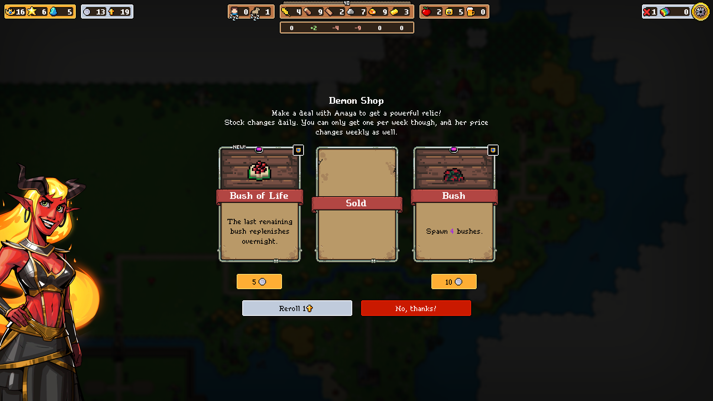

**Amaya Without Cooldown** lets you buy more than one relic from Amaya in the same week in **Super Fantasy Kingdom**. Once you’ve unlocked the Demon Shop, buy a relic and visit Amaya again immediately, even on the same day.

## How the shop works

- **Revisit for free.** The relic you bought is marked **Sold**. The remaining offers stay in their slots at their usual coin prices.
- **Choose when to reroll.** Stock changes daily. To see a new selection sooner, use Amaya’s **Reroll** button. The game applies the displayed faith cost or an available free reroll.
- **Continue your run.** The mod saves the current offers and sold slots with Amaya’s shop.

## Controls

Use the Demon Shop’s usual mouse, keyboard, or controller prompts to buy, reroll, or leave. To make another purchase, select Amaya again on the map.

## Installation

Choose **Install with App**, select your **Super Fantasy Kingdom** profile, and launch with **Start modded**.

## Screenshot

The shop text still describes the base game’s weekly limit. With the mod active, you can buy either remaining offer.
