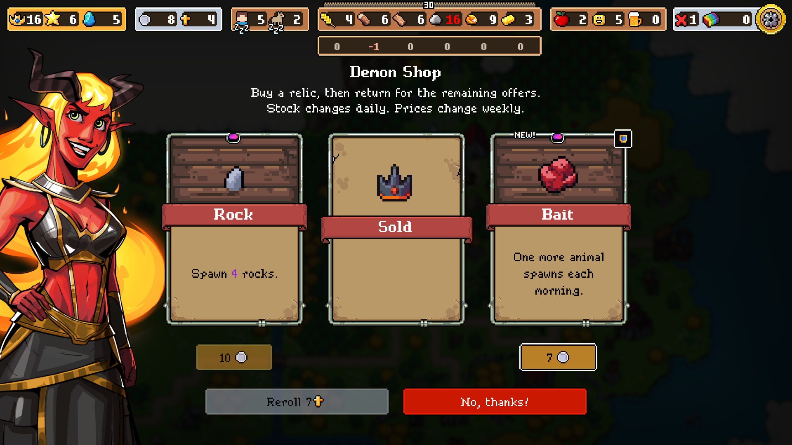

# Amaya Without Cooldown

Once you unlock Amaya's Demon Shop, you can buy a relic and visit her again immediately. On a same-day return, the purchased slot reads **Sold** and the other relics are still available at their usual coin prices.

## Features

- Returning to the shop is free. The purchased slot keeps the relic's icon above its **Sold** ribbon.
- The coin price stays visible on an unaffordable offer. If you lack the Faith for a reroll, you can still see what it costs.
- Stock changes daily. Use **Reroll** for a fresh selection sooner, at the displayed Faith price or with an earned free reroll.
- Continue restores the offers and sold slots saved for that day's shop.

## How to Use

1. Click Amaya on the map, or move the controller cursor over her and press **A**.
2. Click the price beneath a relic to buy it, or focus its buy button and press Confirm (**Enter** or controller **A** by default). After the purchase, select Amaya again to buy another offer.
3. To change the selection, click **Reroll**, or focus it and press Confirm. To leave without buying, click **No, thanks!** or press **Escape** or controller **B**.

## Screenshots

Captured in game on version 0.1.2 at 1920 × 1080 using a virtual controller.

**1× UI scale.** The crown marks the purchased Banished King. With 8 coins, you can still buy Bait for 7.

**1.5× UI scale.** The 10-coin Rock and 7-Faith reroll are out of reach. Both prices remain visible beneath the resource strip.

## Compatibility

- Tested in game with [Weekly Contracts](https://thunderstore.io/c/super-fantasy-kingdom/p/GKJ/WeeklyContracts/) and [Daybook](https://thunderstore.io/c/super-fantasy-kingdom/p/GKJ/Daybook/). The reopened shop clears the resource strip at both UI scales.
- Version 0.1.2 passed offline purchase and reload tests with [MoreRelics 1.1.0](https://thunderstore.io/c/super-fantasy-kingdom/p/ownlyme/MoreRelics/) and with [BakeryUsesWheat 1.2.0](https://thunderstore.io/c/super-fantasy-kingdom/p/ownlyme/BakeryUsesWheat/) also enabled. If a content mod removes a saved offer, its slot shows **Sold** and the other offers keep their positions.
- Older saves can lack the identity of a previously purchased relic. On the first visit, Amaya uses the game's saved reroll state to generate eligible offers.
- A free reroll spends zero Faith at the shop. When Continue replays one recorded reroll from a checkpoint, the base game can deduct one Faith even if that reroll was free.

## Installation

1. Choose **Install with App** on the [Thunderstore listing](https://thunderstore.io/c/super-fantasy-kingdom/p/GKJ/AmayaWithoutCooldown/) and select your **Super Fantasy Kingdom** profile.
2. When prompted, install [BepInExPack](https://thunderstore.io/c/super-fantasy-kingdom/p/BepInEx/BepInExPack/) and [HideManagerGameObject_Config](https://thunderstore.io/c/super-fantasy-kingdom/p/BepInEx/HideManagerGameObject_Config/).
3. Choose **Start modded** and visit Amaya in a run where her shop is unlocked.
