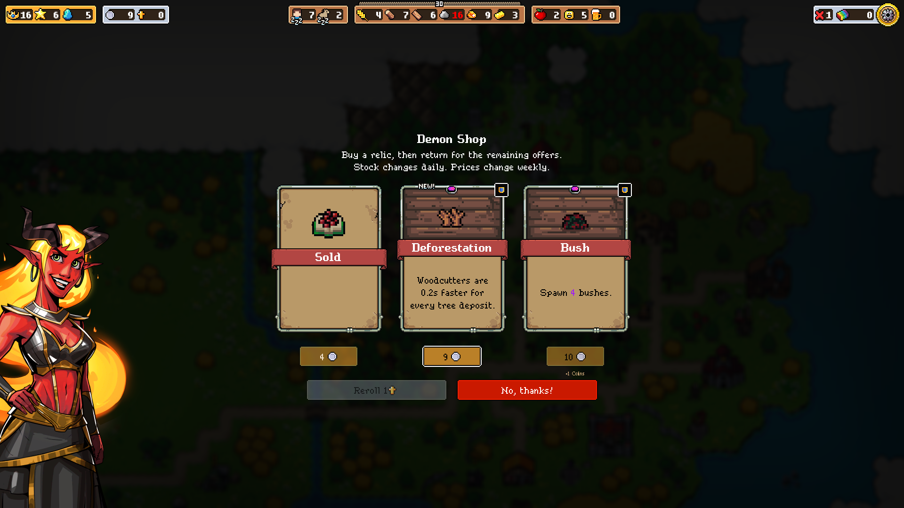
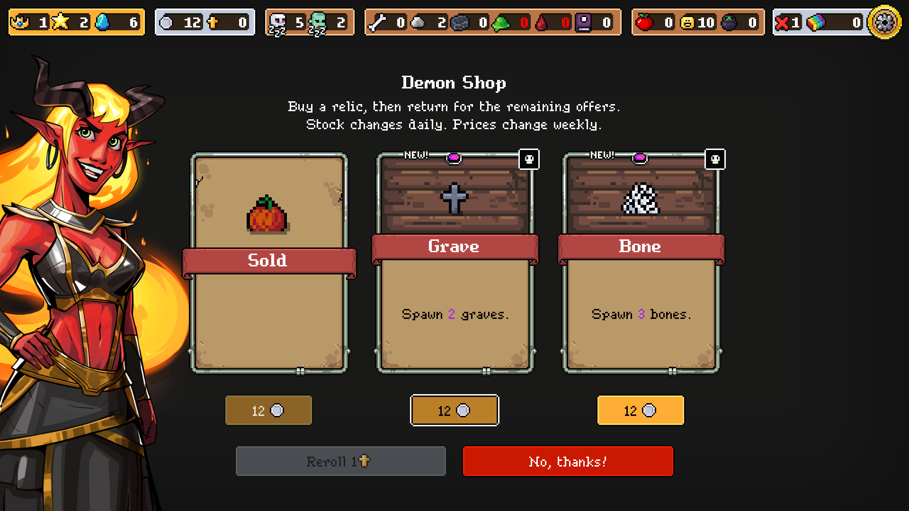

# Amaya Without Cooldown

Once you unlock Amaya's Demon Shop, you can buy a relic and visit her again immediately. On a same-day return, the purchased slot reads **Sold** and the other relics are still available at their usual coin prices.

## Features

- Returning to the shop is free. A purchased slot keeps its relic icon and price visible and is marked **Sold**.
- Unaffordable offers show their prices and how many coins you still need. Reroll stays visible at its displayed Faith price when you cannot afford it.
- Stock changes daily. Use **Reroll** for a fresh selection sooner, at the displayed Faith price or with an earned free reroll.
- Continue restores the offers and sold slots saved for that day's shop.

## How to Use

1. Click Amaya on the map, or move the controller cursor over her and press **A**.
2. Click the price beneath a relic to buy it, or focus its buy button and press Confirm (**Enter** or controller **A** by default). After the purchase, select Amaya again to buy another offer.
3. To change the selection, click **Reroll**, or focus it and press Confirm. To leave without buying, click **No, thanks!** or press **Escape** or controller **B**.

## Screenshots

Captured in game on mod 0.1.5 with a virtual controller.

**Human, 1×.** Deforestation is focused. The left slot keeps the icon and price of the purchased relic, while Bush shows the one-coin shortfall.

**Undead, 1.5×.** Grave is focused, Bone is also available, and the native Reroll button is dimmed because you have no Faith.

## Compatibility

- Verified on Super Fantasy Kingdom **0.8.070** in Human and Undead, including in the combined [GKJ mod](https://thunderstore.io/c/super-fantasy-kingdom/p/GKJ/) profile.
- The shop can share the screen with [Daybook](https://thunderstore.io/c/super-fantasy-kingdom/p/GKJ/Daybook/). [Weekly Contracts](https://thunderstore.io/c/super-fantasy-kingdom/p/GKJ/WeeklyContracts/) rewards preserve Amaya’s sold slots and remaining stock.
- With [More Relics](https://thunderstore.io/c/super-fantasy-kingdom/p/ownlyme/MoreRelics/), Amaya uses the active eligible relic pool. If a saved relic is no longer available, its slot shows **Sold** and the other offers keep their positions.
- Older saves can lack the identity of a previously purchased relic. On the first visit, Amaya uses the game's saved reroll state to generate eligible offers.
- A free reroll spends zero Faith at the shop. When Continue replays one recorded reroll from a checkpoint, the base game can deduct one Faith even if that reroll was free.
- The combined 0.8.070 profile also loaded [Achievement Enabler](https://thunderstore.io/c/super-fantasy-kingdom/p/ownlyme/AchievementEnabler/), [Bakery Uses Wheat](https://thunderstore.io/c/super-fantasy-kingdom/p/ownlyme/BakeryUsesWheat/), [Right Click Skip](https://thunderstore.io/c/super-fantasy-kingdom/p/ownlyme/RightClickSkip/), and [Tavern Food Priorities](https://thunderstore.io/c/super-fantasy-kingdom/p/ownlyme/TavernFoodPriorities/).

## Installation

1. Choose **Install with App** on the [Thunderstore listing](https://thunderstore.io/c/super-fantasy-kingdom/p/GKJ/AmayaWithoutCooldown/) and select your **Super Fantasy Kingdom** profile.
2. When prompted, install [BepInExPack](https://thunderstore.io/c/super-fantasy-kingdom/p/BepInEx/BepInExPack/) and [HideManagerGameObject_Config](https://thunderstore.io/c/super-fantasy-kingdom/p/BepInEx/HideManagerGameObject_Config/).
3. Choose **Start modded** and visit Amaya in a run where her shop is unlocked.

[Support GKJ Games on Ko-fi](https://ko-fi.com/gkj_games)
