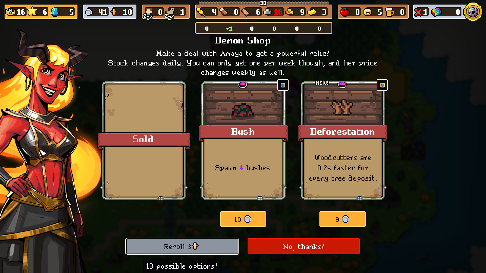

**Amaya Without Cooldown** lets you buy more than one relic from Amaya in the same week in **Super Fantasy Kingdom**. Once you’ve unlocked the Demon Shop, buy a relic and visit Amaya again immediately, even on the same day.

## How the shop works

- **Revisit for free.** The relic you bought is marked **Sold**. The remaining offers stay in their slots at their usual coin prices.
- **Choose when to reroll.** Stock changes daily. To see a new selection sooner, use Amaya’s **Reroll** button. The game applies the displayed Faith cost or an available free reroll. A free reroll spends zero Faith at the shop. When Continue replays a reroll from a checkpoint, the base game can still deduct Faith, including one Faith for a single recorded reroll.
- **Continue your run.** The mod saves the current offers and sold slots with Amaya’s shop.

## Controls

Click **Reroll**, or move focus to it and press Confirm (Enter or controller A by default). The number beside the Faith icon is the price. To leave while an offer is focused, press Back (Escape or controller B by default). Select Amaya again on the map to reopen her shop.

## Installation

Choose **Install with App**, select your **Super Fantasy Kingdom** profile, and launch with **Start modded**.

## Inside the Demon Shop

These in-game captures show the shop after a same-day return in 0.1.0, using simulated controller input. The shop description still mentions the base game's weekly limit.

**1× UI scale.** The left slot is sold. Bait costs 7 coins and Cookies with Milk costs 9. The white outline marks the selected buy button.

**1.5× UI scale.** In this run, Bush and Deforestation remain available. Reroll has focus and shows a cost of 3 Faith.
