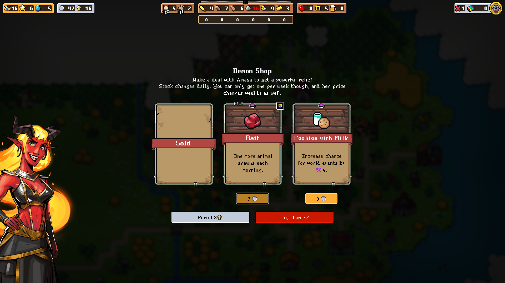

Once you unlock Amaya's Demon Shop, you can buy a relic and visit her again immediately. On a same-day return, the purchased slot reads **Sold** and the other relics are still available at their usual coin prices.

## Features

- Returning to the shop is free. Each purchase marks just its own slot as sold.
- Stock changes daily. Use **Reroll** for a fresh selection sooner, at the displayed Faith price or with an earned free reroll.
- Continue restores the offers and sold slots saved for that day's shop.

## How to Use

1. Click Amaya on the map, or move the controller cursor over her and press **A**.
2. Click the price beneath a relic to buy it, or focus its buy button and press Confirm (**Enter** or controller **A** by default). After the purchase, select Amaya again to buy another offer.
3. To change the selection, click **Reroll**, or focus it and press Confirm. To leave without buying, click **No, thanks!** or press **Escape** or controller **B**.

## Screenshots

These in-game captures show the shop after a same-day return in 0.1.0, using simulated controller input. The shop description still mentions the base game's weekly limit.

**1× UI scale.** The left slot is sold. Bait costs 7 coins and Cookies with Milk costs 9. The white outline marks the selected buy button.

**1.5× UI scale.** In this run, Bush and Deforestation remain available. Reroll has focus and shows a cost of 3 Faith.

## Compatibility

Version 0.1.1 passed offline purchase and reload tests with MoreRelics 1.1.0, both on its own and alongside BakeryUsesWheat 1.2.0. If a content mod removes a saved offer, its slot shows **Sold** and the remaining offers keep their positions.

A free reroll spends zero Faith at the shop. When Continue replays one recorded reroll from a checkpoint, the base game can deduct one Faith even if that reroll was free.

## Installation

Choose **Install with App**, select your **Super Fantasy Kingdom** profile, and install the listed BepInEx dependencies when prompted. Launch with **Start modded** and visit Amaya in a run where her shop is unlocked.
